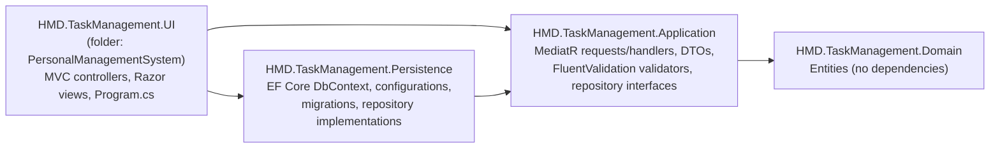
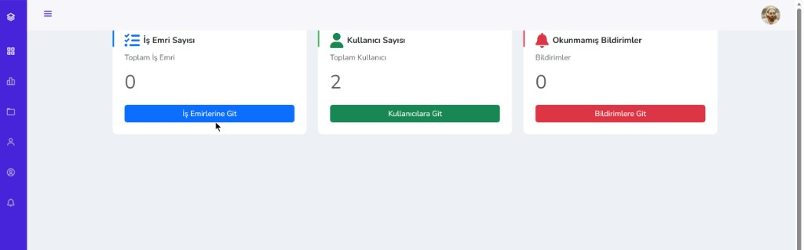
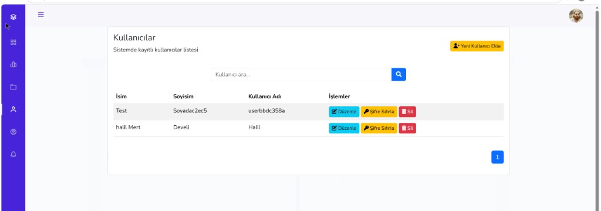
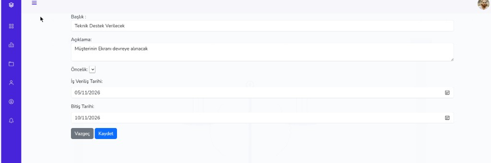
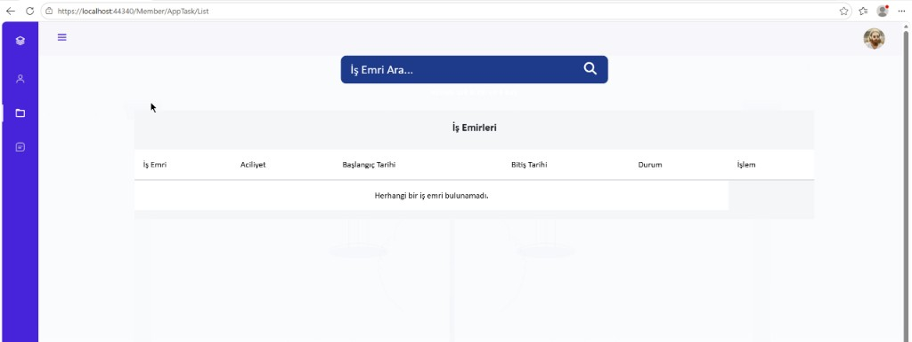

# Task Management System

A role-based work-order (task) management web application built with **ASP.NET Core MVC on .NET 8**, structured as an onion-style layered solution with **MediatR**, **FluentValidation** and **EF Core + SQL Server**. It was my Computer Engineering **capstone project**.

> Status: completed academic project, not deployed anywhere. No automated tests or CI. See [Limitations](#limitations) before reusing any of it.

---

## Overview

Two roles share one application:

- **Admin**: creates and assigns work orders, manages members and priority levels, reads task reports, and receives notifications.
- **Member**: sees the work orders assigned to them, writes progress reports, marks work as completed, and receives assignment notifications.

Users sign in with cookie authentication and are routed to an `Admin` or `Member` MVC area based on their role. The UI text is in Turkish.

## Problem & Solution

**Problem:** In a small team, work requests, who owns them and how far along they are tend to live in chat messages and spreadsheets, so nobody has a single, current view.

**Solution:** One web app where an admin records each work order with a priority and start/end dates, assigns it to a member, and follows progress through the reports the member writes. Assignment, new reports and completion generate in-app notifications.

## Features

**Admin area** (`[Authorize(Roles = "Admin")]`)
- Dashboard with counts of work orders, members and unread notifications.
- Work orders: paginated list with search; create (title, description, priority, start/end date), update and assign to a member, delete. The edit page shows the task's reports.
- Members: paginated list with search; create, update, delete, reset password.
- Priorities: create, update, delete.
- Notifications: list and mark as read.
- Own profile: update name, surname and password.

**Member area** (`[Authorize(Roles = "Member")]`)
- Assigned work orders: paginated list with search.
- Task reports: create, edit and delete progress reports per task.
- Mark a task as completed.
- Notifications and own profile.

**Account**
- Login, self-registration (always creates a Member), logout.

## Tech Stack

| Area | Technology (version from project files) |
|---|---|
| Runtime | .NET 8 (`net8.0`, all four projects) |
| Web | ASP.NET Core MVC, Razor views, MVC Areas, a view component |
| Application | MediatR 12.4.1 (requests and handlers), FluentValidation 11.11.0 |
| Data | Entity Framework Core 8.0.0, SQL Server provider, code-first migrations |
| Auth | ASP.NET Core cookie authentication with role claims |
| Front end | Bootstrap 5, jQuery and jQuery Validation (vendored in `wwwroot`), Font Awesome (CDN) |

## Architecture

Dependencies point inward. This is taken from the `ProjectReference` entries in the `.csproj` files:



- **Request flow:** controller → `IMediator.Send(request)` → handler in Application → repository interface → EF Core implementation in Persistence → SQL Server.
- **Repository interfaces** (`IUserRepository`, `IAppTaskRepository`, `IPriorityRepository`, `ITaskReportRepository`, `INotificationRepository`) are defined in Application and implemented in Persistence. The Application project has no EF Core reference.
- **Validation:** each handler creates its FluentValidation validator and runs it before executing the use case. Validators are not registered in DI or in an MVC/MediatR pipeline.
- **Composition root:** `PersonalManagementSystem/Program.cs` calls `AddPersistenceServices` and `AddApplicationServices`, configures the cookie (HttpOnly, `SameSite=Strict`) and maps the area and default routes. The default route opens `Account/Login`.
- **Domain entities:** `AppUser`, `AppRole`, `AppTasks`, `Priority`, `TaskReport`, `Notification`.

## Screenshots

These are the screenshots already in `docs/images/`. The UI is in Turkish.

| Admin dashboard | Admin: member management |
|---|---|
|  |  |
| **Admin: work order form** | **Member: assigned work orders** |
|  |  |

More screenshots: [admin work order list](docs/images/admin/admin-work-orders.png), [admin profile](docs/images/admin/admin-profile.png), [member profile](docs/images/member/member-profile.png), [member layout](docs/images/member/member-dashboard.png).

## Getting Started

### Prerequisites

- [.NET 8 SDK](https://dotnet.microsoft.com/download/dotnet/8.0)
- SQL Server. LocalDB (`(localdb)\MSSQLLocalDB`, installed with Visual Studio) works for local development.
- Optional: `dotnet-ef` for running migrations by hand (`dotnet tool install --global dotnet-ef`).

### Configuration

The app reads the connection string named **`Local`** (`ConnectionStrings:Local`). `PersonalManagementSystem/appsettings.json` ships with a LocalDB default that uses Windows integrated security and contains no password. If that works for you, you can skip this step.

To point at another server without editing tracked files, use an **environment variable**, which ASP.NET Core always reads:

```powershell
# PowerShell
$env:ConnectionStrings__Local = "Server=<host>;Database=TaskManagementDb;User Id=<user>;Password=<password>;TrustServerCertificate=True"
```

```bash
# bash
export ConnectionStrings__Local="Server=<host>;Database=TaskManagementDb;User Id=<user>;Password=<password>;TrustServerCertificate=True"
```

You can also use **user-secrets**. The UI project has no `UserSecretsId` yet, so initialise it first (this adds a `UserSecretsId` to the `.csproj` on your machine):

```bash
dotnet user-secrets init --project PersonalManagementSystem
dotnet user-secrets set "ConnectionStrings:Local" "<your connection string>" --project PersonalManagementSystem
```

Do not commit credentials to `appsettings*.json`.

### Database and migrations

Migrations live in `HMD.TaskManagement.Persistence/Migrations`. **On startup the app calls `Database.Migrate()`**, so the database is created and updated automatically if the connection string works. Startup also inserts the two role rows (`1 = Admin`, `2 = Member`) when they are missing.

To apply migrations by hand instead:

```bash
dotnet ef database update --project HMD.TaskManagement.Persistence --startup-project PersonalManagementSystem
```

### Run

```bash
dotnet restore PersonalManagementSystem.sln
dotnet build PersonalManagementSystem.sln
dotnet run --project PersonalManagementSystem --launch-profile https
```

Then open `https://localhost:7276` (from `Properties/launchSettings.json`).

> On Windows, the UI `.csproj` has a pre-build step that runs `taskkill` on any running `HMD.TaskManagement.UI.exe` and `iisexpress.exe` processes to avoid locked-file errors.

### First admin account

No users are seeded, and self-registration always creates a **Member**. To get an admin:

1. Register at `/Account/Register`.
2. Promote that user in SQL Server:
   ```sql
   UPDATE Users SET AppRoleId = 1 WHERE UserName = N'<your-username>';
   ```
3. Sign out and sign in again.

Notifications for new reports and completed tasks are always sent to the user with **Id 1** (see [Limitations](#limitations)), so on a fresh database the first registered account should be the admin.

## Testing

There are **no automated tests** in this repository and **no CI pipeline**. The solution builds with the .NET 8 SDK (`dotnet build`). The first build reports nullable-reference warnings in the Application handlers. All verification so far has been manual, through the UI.

## Project Status

- Built as a Computer Engineering capstone project between February and May 2025.
- Small follow-up changes in May 2026: a migration that makes a task's assignee nullable, plus documentation and screenshots.
- Not deployed, and not maintained as a product.

## My Contributions

This is a solo project. Every commit in the history is mine. I designed the layered solution structure, the domain model and EF Core mappings, the MediatR request/handler and validation flow, cookie-based role authorization, and the Admin and Member MVC areas with their Razor views and styling. The vendored front-end libraries and the UI template listed below are third-party code.

## Limitations

These are known issues in the current code. I am listing them openly rather than hiding them:

- **Passwords are stored and compared in plain text.** There is no hashing (`AppUser.Password`, `LoginRequestHandler`).
- **Admin-created members and password resets use a fixed default password** that is hard-coded in the Application handlers.
- **No per-user authorization checks on member actions.** Reports and task completion are addressed by id, and the handlers do not check that the task belongs to the signed-in member. Several state-changing actions (delete, complete, mark as read) are plain `GET` links, and no anti-forgery validation is applied. The `SameSite=Strict` cookie reduces, but does not remove, the CSRF exposure.
- **Notifications assume a single admin with user Id 1** (hard-coded in `TaskReportCreateHandler` and `AppTaskCompleteRequestHandler`).
- **Leftover debug instrumentation:** `LoginRequestHandler`, `AccountController` and the Persistence `IOCExtensions` append JSON lines (including login usernames) to a hard-coded local file path. Any failure is swallowed, so on other machines this does nothing, but it should be removed.
- Startup runs `Database.Migrate()` and raw SQL schema fixes automatically. That is convenient for a demo but not what you want in production.
- No tests, no CI, no containerisation, no logging or monitoring setup.
- The UI is Turkish-only. The `wwwroot` folder contains three copies of Bootstrap (see below).

## Third-party code and licences

Vendored under `PersonalManagementSystem/wwwroot/` (all MIT-licensed, with their licence headers or files kept in place):

| Path | Component |
|---|---|
| `lib/bootstrap`, `lib/jquery`, `lib/jquery-validation`, `lib/jquery-validation-unobtrusive` | Default ASP.NET Core MVC template libraries (Bootstrap 5.1, jQuery 3.6, jQuery Validation 1.19.5, jQuery Validation Unobtrusive), each with its `LICENSE` file |
| `bootstrap/`, `twitter-bootstrap/` | Bootstrap 5.3.3, restored via LibMan (`libman.json`) |
| `theme/` | [Start Bootstrap "Simple Sidebar"](https://startbootstrap.com/template/simple-sidebar) v6.0.6, MIT, by Start Bootstrap |

Font Awesome and one Bootstrap bundle are loaded from public CDNs at runtime. NuGet dependencies (MediatR, FluentValidation, EF Core) are restored at build time and are not vendored.

The repository does not currently include a licence for its own code.
