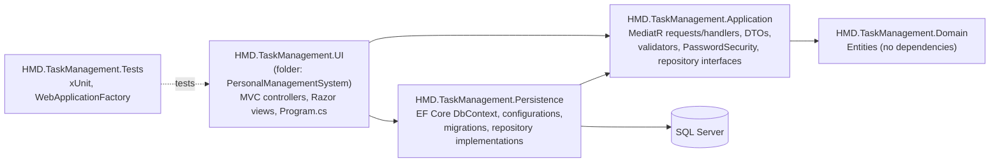
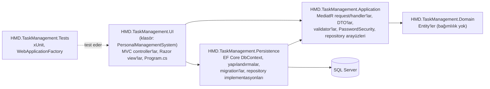

<div align="center">

# Task Management System

**A role-based work-order manager for small teams, built with ASP.NET Core MVC on .NET 8 in an onion-style layered solution.**
<br/>
<sub>Küçük ekipler için rol tabanlı iş emri yönetim uygulaması; .NET 8 üzerinde ASP.NET Core MVC ile, onion tarzı katmanlı bir çözüm olarak geliştirildi.</sub>

<br/>

[](https://github.com/HalilMertDeveli/TaskManagementSystem/actions/workflows/ci.yml)


</div>

<p align="center"><a href="#english">English</a> · <a href="#turkce">Türkçe</a></p>

| | |
|---|---|
| **Type · Tür** | Web application (server-rendered MVC) · Web uygulaması (sunucu taraflı MVC) |
| **Status · Durum** | Completed capstone project, security-hardened afterwards, not deployed · Tamamlanmış bitirme projesi, sonradan güvenlik açısından iyileştirildi, yayında değil |
| **Stack · Teknoloji** | .NET 8, ASP.NET Core MVC, MediatR 12.4.1, FluentValidation 11.11.0, EF Core 8.0.21, SQL Server |
| **Architecture · Mimari** | Onion-style: Domain, Application, Persistence, UI · Onion tarzı: Domain, Application, Persistence, UI |
| **Roles · Roller** | Admin, Member · Yönetici, Üye |
| **Quality · Kalite** | 58 xUnit tests (unit + integration on a real SQL Server), GitHub Actions CI · 58 xUnit testi (birim + gerçek SQL Server üzerinde entegrasyon), GitHub Actions CI |
| **Category · Kategori** | Portfolio / Academic · Portföy / Akademik |

<p align="center">
  
  <br/>
  <sub>Admin dashboard · Yönetici paneli (the UI is in Turkish · arayüz Türkçedir)</sub>
</p>

---

<a id="english"></a>

## Overview

Task Management System was my Computer Engineering **capstone project**. Two roles share one application:

- **Admin** creates and assigns work orders, manages members and priority levels, reads task reports and receives notifications.
- **Member** sees the work orders assigned to them, writes progress reports, marks work as completed and receives assignment notifications.

Users sign in with cookie authentication and are routed to an `Admin` or `Member` MVC area based on their role. The UI text is in Turkish.

> [!NOTE]
> Completed academic project, not deployed. It was security-hardened afterwards (hashed passwords, `POST` + anti-forgery for every state change, per-user ownership checks) and now has integration tests and CI. Read [Security](#security) and [Limitations](#limitations) before reusing any of it.

## Problem and solution

**Problem:** in a small team, work requests, who owns them and how far along they are tend to live in chat messages and spreadsheets, so nobody has a single, current view.

**Solution:** one web app where an admin records each work order with a priority and start/end dates, assigns it to a member, and follows progress through the reports the member writes. Assignment, new reports and completion generate in-app notifications.

## Features

| Area | Capability | Where |
|---|---|---|
| Admin: dashboard | Counts of work orders, members and unread notifications | `Controllers/Admin/HomeController.cs`, `Handlers/Dashboard` |
| Admin: work orders | Paginated list with search; create (title, description, priority, start/end date), update, assign to a member, delete; the edit page shows the task's reports | `Controllers/Admin/AppTaskController.cs`, `Handlers/AppTask` |
| Admin: members | Paginated list with search; create, update, delete, reset password. Create and reset show a random temporary password once | `Controllers/Admin/UserController.cs`, `Handlers/Account` |
| Admin: priorities | Create, update, delete | `Controllers/Admin/PriorityController.cs`, `Handlers/Priority` |
| Member: work orders | Assigned work orders with search; mark a task as completed | `Controllers/Member/AppTaskController.cs` |
| Member: task reports | Create, edit and delete progress reports on their own tasks | `Handlers/TaskReport`, `ViewComponents/TaskReportsViewComponent.cs` |
| Both: notifications | List and mark their own notifications as read | `Controllers/*/NotificationController.cs`, `Handlers/Notification` |
| Both: profile | Update name, surname and password | `Controllers/*/UserController.cs` |
| Account | Login, self-registration (always creates a Member), logout | `Controllers/AccountController.cs` |

Admin and Member controllers are protected with `[Authorize(Roles = "Admin")]` and `[Authorize(Roles = "Member")]`. Ownership is checked again in the Application handlers (see [Security](#security)).

## Tech stack

| Area | Technology (version from project files) |
|---|---|
| Runtime | .NET 8 (`net8.0`, all projects) |
| Web | ASP.NET Core MVC, Razor views, MVC Areas, a view component |
| Application | MediatR 12.4.1 (requests and handlers), FluentValidation 11.11.0 |
| Data | Entity Framework Core 8.0.21, SQL Server provider, code-first migrations |
| Auth | Cookie authentication with role claims; passwords hashed with ASP.NET Core Identity's `PasswordHasher<T>` (`Microsoft.Extensions.Identity.Core` 8.0.21) |
| Tests | xUnit 2.9, `Microsoft.AspNetCore.Mvc.Testing` (`WebApplicationFactory`) against SQL Server |
| CI | GitHub Actions, `ubuntu-latest`, SQL Server 2022 container |
| Front end | Bootstrap 5, jQuery and jQuery Validation (vendored in `wwwroot`), Font Awesome (CDN) |

## Architecture

Dependencies point inward. The diagram is taken from the `ProjectReference` entries in the `.csproj` files.



<sub>Project references between the .NET projects · .NET projeleri arasındaki proje referansları</sub>

- **Request flow:** controller → `IMediator.Send(request)` → handler in Application → repository interface → EF Core implementation in Persistence → SQL Server.
- **Repository interfaces** (`IUserRepository`, `IAppTaskRepository`, `IPriorityRepository`, `ITaskReportRepository`, `INotificationRepository`) are defined in Application and implemented in Persistence. The Application project has no EF Core reference.
- **Validation:** each handler creates its FluentValidation validator and runs it before executing the use case. Validators are not registered in DI or in an MVC/MediatR pipeline.
- **Composition root:** `PersonalManagementSystem/Program.cs` calls `AddPersistenceServices` and `AddApplicationServices`, registers a global `AutoValidateAntiforgeryTokenAttribute`, configures the cookie (`PersonalManagementLCookie`, HttpOnly, `SameSite=Strict`) and maps the area and default routes. The default route opens `Account/Login`.

## Repository structure

```text
TaskManagementSystem/
├── .github/workflows/ci.yml          # Restore, build, test against a SQL Server container
├── HMD.TaskManagement.Domain/        # Entities: AppUser, AppRole, AppTasks, Priority, TaskReport, Notification
├── HMD.TaskManagement.Application/   # MediatR requests + handlers, DTOs, validators, Security/PasswordSecurity.cs
├── HMD.TaskManagement.Persistence/   # DbContext, entity configurations, migrations, repositories
├── HMD.TaskManagement.Tests/         # xUnit unit + integration tests
├── PersonalManagementSystem/         # UI project (HMD.TaskManagement.UI.csproj)
│   ├── Areas/Admin, Areas/Member     # Razor views per role
│   ├── Controllers/Admin, /Member    # Role-protected MVC controllers
│   ├── ViewComponents/               # TaskReportsViewComponent
│   └── Program.cs                    # Composition root, cookie auth, anti-forgery filter, startup migration
├── docs/images/                      # Screenshots
└── PersonalManagementSystem.sln
```

## Data model and startup

- **Entities:** `AppUser`, `AppRole`, `AppTasks`, `Priority`, `TaskReport`, `Notification`, mapped with EF Core configuration classes in `HMD.TaskManagement.Persistence/Configurations`.
- **Migrations** live in `HMD.TaskManagement.Persistence/Migrations` (four migrations, February 2025 to May 2026).
- **Startup:** `Program.cs` calls `Database.Migrate()`, runs a raw SQL fix that makes the task assignee column nullable when needed, and inserts the two role rows (`1 = Admin`, `2 = Member`) when they are missing.

## Security

What the application does today:

- **Password storage.** Passwords are hashed with ASP.NET Core Identity's `PasswordHasher<AppUser>` (PBKDF2, per-user salt). Registration, admin-created members, admin password resets and profile changes all store hashes. The hash is never returned to the UI, and the profile page has an empty "new password" field (blank keeps the current password).
- **Password length.** New passwords (registration and profile) must be 8 to 128 characters.
- **No default password.** Creating a member or resetting a member's password generates a random 16-character temporary password. It is rendered once in the `POST` response (with `Cache-Control: no-store`); only its hash is stored. Hand it to the user over a secure channel and ask them to change it on their profile page.
- **Legacy plain-text passwords** are migrated on login without locking anyone out. See [Upgrading an existing database](#upgrading-an-existing-database).
- **State-changing requests** (delete, complete, reset password, mark as read, log out and all forms) are `POST` only and need a valid anti-forgery token. A global `AutoValidateAntiforgeryTokenAttribute` rejects a missing or invalid token with `400`. A `GET` to these URLs is rejected (`405`, or `404` where no `GET` route exists) and changes nothing.
- **Authorization.** The Admin and Member areas keep their role checks. Member actions also check ownership in the Application handlers: a member can only complete, report on, edit or delete reports of tasks assigned to them, and anyone can only mark their own notifications as read. Profile updates always use the signed-in user's id, never one from the form. Admin member-management actions only affect users with the Member role. A resource that is missing or belongs to someone else returns `404`.
- **Notifications** for new reports and completed tasks go to every user with the Admin role (no hard-coded user id).
- **Logging.** The debug code that wrote usernames and exception messages to a local file has been removed. Unexpected login errors go to the standard ASP.NET Core logger, without request data.

### Upgrading an existing database

No schema change was needed: the `Password` column is `nvarchar(200)` and a hash is 84 characters, so there is no new migration.

Rows that still hold a plain-text password keep working. On the next successful login the stored value is detected as "not a hasher-format hash" and compared to the supplied password in constant time (both sides are reduced to SHA-256 digests, then compared with `CryptographicOperations.FixedTimeEquals`). If they match, the value is replaced with a hash right away. Hashes that `PasswordHasher` reports as `SuccessRehashNeeded` are rehashed the same way. Accounts that never log in again keep their plain-text value until an admin resets their password; reset those accounts, or run a one-off script that resets every row not in hasher format.

## Getting started

### Prerequisites

- [.NET 8 SDK](https://dotnet.microsoft.com/download/dotnet/8.0)
- SQL Server. LocalDB (`(localdb)\MSSQLLocalDB`, installed with Visual Studio) works for local development and for the tests.
- Optional: `dotnet-ef` for running migrations by hand (`dotnet tool install --global dotnet-ef`).

### Configuration

The app reads the connection string named **`Local`** (`ConnectionStrings:Local`). `PersonalManagementSystem/appsettings.json` ships with a LocalDB default that uses Windows integrated security and contains no password. To point at another server without editing tracked files, use an environment variable:

```powershell
# PowerShell
$env:ConnectionStrings__Local = "<your-connection-string>"
```

```bash
# bash
export ConnectionStrings__Local="<your-connection-string>"
```

Or use user-secrets. The UI project has no `UserSecretsId` yet, so initialise it first:

```bash
dotnet user-secrets init --project PersonalManagementSystem
dotnet user-secrets set "ConnectionStrings:Local" "<your-connection-string>" --project PersonalManagementSystem
```

Do not commit credentials to `appsettings*.json`.

### Run

```bash
dotnet restore PersonalManagementSystem.sln
dotnet build PersonalManagementSystem.sln
dotnet run --project PersonalManagementSystem --launch-profile https
```

Then open `https://localhost:7276` (from `Properties/launchSettings.json`). The database is created and migrated on first start. To apply migrations by hand instead:

```bash
dotnet ef database update --project HMD.TaskManagement.Persistence --startup-project PersonalManagementSystem
```

> On Windows, the UI `.csproj` has a pre-build step that runs `taskkill` on any running `HMD.TaskManagement.UI.exe` and `iisexpress.exe` processes to avoid locked-file errors. Building the tests also builds the UI project, so stop any instance you care about first.

### First admin account

No users are seeded, and self-registration always creates a **Member**. To get an admin:

1. Register at `/Account/Register`.
2. Promote that user in SQL Server:
   ```sql
   UPDATE Users SET AppRoleId = 1 WHERE UserName = N'<your-username>';
   ```
3. Sign out and sign in again.

## Testing

`HMD.TaskManagement.Tests` (xUnit, 58 tests) has unit tests for the password helpers and integration tests that boot the real application with `WebApplicationFactory<Program>`. They use the real `Program.cs` pipeline (MVC filters, cookie auth, anti-forgery) and a real SQL Server database. Each run creates a database named `TmsTests_<guid>`, applies the EF Core migrations through the normal startup path and drops the database at the end.

SQL Server rather than SQLite or the in-memory provider: the migrations and the startup schema fixes are SQL Server specific, and the in-memory provider would not exercise real queries, constraints or cascades.

| Test file | Covers |
|---|---|
| `PasswordSecurityTests.cs` | Hash format detection, constant-time legacy comparison, temporary password generation |
| `AuthenticationTests.cs` | Hashing on register, member create, reset and profile change; correct, wrong and unknown-user logins; legacy plain-text login migrated to a hash |
| `HttpSecurityTests.cs` | `GET` never deletes or changes data; missing, invalid or foreign anti-forgery tokens rejected; unauthenticated requests redirected to login; members kept out of admin pages and actions |
| `OwnershipTests.cs` | Members cannot act on another member's tasks, reports, notifications or profile; the valid, authorized versions succeed |

```bash
# Uses SQL Server LocalDB by default: (localdb)\MSSQLLocalDB
dotnet test PersonalManagementSystem.sln

# Any other SQL Server: give a connection string without a database name
export TMS_TEST_SQLSERVER="Server=localhost,1433;User ID=sa;Password=<password>;TrustServerCertificate=True"
dotnet test PersonalManagementSystem.sln
```

The account in `TMS_TEST_SQLSERVER` must be allowed to create and drop databases.

### CI

[`.github/workflows/ci.yml`](.github/workflows/ci.yml) runs on pushes to `master`, on pull requests and on manual dispatch. On `ubuntu-latest` it starts a SQL Server 2022 container with a per-run random SA password (masked in the log, never stored in the repository), then restores, builds in Release, runs all tests and uploads the TRX results as an artifact.

## Screenshots

| | |
|---|---|
|  |  |
| <sub>Admin: member management · Yönetici: üye yönetimi</sub> | <sub>Admin: work orders · Yönetici: iş emirleri</sub> |
|  |  |
| <sub>Admin: work order form · Yönetici: iş emri formu</sub> | <sub>Admin: profile · Yönetici: profil</sub> |
|  |  |
| <sub>Member: assigned work orders · Üye: atanan iş emirleri</sub> | <sub>Member: layout · Üye: arayüz</sub> |
|  | |
| <sub>Member: profile · Üye: profil</sub> | |

## Engineering notes

- **Why MediatR:** controllers stay thin and every use case is one request/handler pair, so the Application layer is the single place to read business rules, including ownership checks.
- **Trade-off:** validators are instantiated inside handlers instead of a MediatR pipeline behaviour. It is explicit and easy to follow, but every handler repeats the same pattern.
- **Integration tests over mocks:** the security fixes span filters, routing and handlers, so the tests drive real HTTP requests through the full pipeline instead of unit-testing controllers in isolation.
- **Startup schema repair:** `Program.cs` tolerates databases that missed the nullable-assignee migration. Convenient for a demo; in production, migrations would run as a separate deployment step.

## Limitations

These are known issues in the current code:

- **Plain-text passwords remain until the next login.** Legacy accounts are migrated only when they log in successfully (see [Upgrading an existing database](#upgrading-an-existing-database)).
- **Temporary passwords are not forced to change.** Nothing forces a user to change an admin-issued temporary password at the next login; that would need a new column and a migration.
- **No brute-force protection.** There is no account lockout, rate limiting or CAPTCHA on login. Changing your password on the profile page does not ask for the current password, and existing auth cookies stay valid after a password change (no security-stamp check).
- **User names are not unique in the schema.** Registration and member creation reject a user name that is already taken, but the database has no unique index on `UserName`; the existing unique index is on `Surname`, which is a schema quirk.
- **Access denied page:** forbidden requests are redirected to `/Account/AccessDenied`, which has no action, so the user sees a 404 page.
- Startup runs `Database.Migrate()` and raw SQL schema fixes automatically.
- No containerisation for the app itself, and no logging or monitoring setup.
- The UI is Turkish-only. `wwwroot` contains three copies of Bootstrap.

## Project status

- Built as a Computer Engineering capstone project between February and May 2025.
- May 2026: a migration that makes a task's assignee nullable, plus documentation and screenshots.
- November 2026: security hardening, integration tests, CI, EF Core 8.0.21 and repository cleanup.
- Not deployed and not maintained as a product.

## My contributions

This is a solo project; every commit in the history is mine. I designed the layered solution structure, the domain model and EF Core mappings, the MediatR request/handler and validation flow, cookie-based role authorization, the Admin and Member MVC areas with their Razor views and styling, and the later security hardening, tests and CI. The vendored front-end libraries and the UI template listed below are third-party code.

## Third-party code and licences

Vendored under `PersonalManagementSystem/wwwroot/` (all MIT-licensed, with their licence headers or files kept in place):

| Path | Component |
|---|---|
| `lib/bootstrap`, `lib/jquery`, `lib/jquery-validation`, `lib/jquery-validation-unobtrusive` | Default ASP.NET Core MVC template libraries (Bootstrap 5.1, jQuery 3.6, jQuery Validation 1.19.5, jQuery Validation Unobtrusive), each with its `LICENSE` file |
| `bootstrap/`, `twitter-bootstrap/` | Bootstrap 5.3.3, restored via LibMan (`libman.json`) |
| `theme/` | [Start Bootstrap "Simple Sidebar"](https://startbootstrap.com/template/simple-sidebar) v6.0.6, MIT, by Start Bootstrap |

`.gitattributes` marks these folders as `linguist-vendored` and the EF Core migration designer files as `linguist-generated`, so GitHub's language bar counts only first-party code. Font Awesome and one Bootstrap bundle are loaded from public CDNs at runtime. NuGet dependencies are restored at build time and are not vendored. The repository does not currently include a licence for its own code.

<p align="right"><a href="#english">Back to top ↑</a></p>

---

<a id="turkce"></a>

## Genel Bakış

Task Management System, Bilgisayar Mühendisliği **bitirme projem** olarak geliştirildi. Tek uygulamayı iki rol paylaşır:

- **Yönetici (Admin)** iş emirlerini oluşturur ve atar, üyeleri ve öncelik seviyelerini yönetir, görev raporlarını okur ve bildirim alır.
- **Üye (Member)** kendisine atanan iş emirlerini görür, ilerleme raporları yazar, işi tamamlandı olarak işaretler ve atama bildirimleri alır.

Kullanıcılar cookie tabanlı kimlik doğrulama ile giriş yapar ve rollerine göre `Admin` veya `Member` MVC alanına yönlendirilir. Arayüz metinleri Türkçedir.

> [!NOTE]
> Tamamlanmış ve yayına alınmamış bir akademik projedir. Sonradan güvenlik açısından iyileştirildi (hash'lenmiş parolalar, durum değiştiren her işlem için `POST` + anti-forgery, kullanıcıya özel sahiplik kontrolleri); artık entegrasyon testleri ve CI da var. Yeniden kullanmadan önce [Güvenlik](#guvenlik) ve [Sınırlamalar](#sinirlamalar) bölümlerini okuyun.

## Problem ve Çözüm

**Problem:** küçük ekiplerde iş talepleri, sorumluları ve ilerleme durumu genellikle sohbet mesajlarında ve tablolarda kalır; kimsenin tek ve güncel bir görünümü olmaz.

**Çözüm:** yöneticinin her iş emrini öncelik ve başlangıç/bitiş tarihleriyle kaydettiği, bir üyeye atadığı ve üyenin yazdığı raporlarla ilerlemeyi takip ettiği tek bir web uygulaması. Atama, yeni rapor ve tamamlama işlemleri uygulama içi bildirim üretir.

## Özellikler

| Alan | Yetenek | Konum |
|---|---|---|
| Yönetici: panel | İş emri, üye ve okunmamış bildirim sayıları | `Controllers/Admin/HomeController.cs`, `Handlers/Dashboard` |
| Yönetici: iş emirleri | Arama destekli sayfalı liste; oluşturma (başlık, açıklama, öncelik, başlangıç/bitiş tarihi), güncelleme, üyeye atama, silme; düzenleme sayfasında görevin raporları | `Controllers/Admin/AppTaskController.cs`, `Handlers/AppTask` |
| Yönetici: üyeler | Arama destekli sayfalı liste; oluşturma, güncelleme, silme, parola sıfırlama. Oluşturma ve sıfırlamada rastgele geçici parola bir kez gösterilir | `Controllers/Admin/UserController.cs`, `Handlers/Account` |
| Yönetici: öncelikler | Oluşturma, güncelleme, silme | `Controllers/Admin/PriorityController.cs`, `Handlers/Priority` |
| Üye: iş emirleri | Atanan iş emirlerinde arama; görevi tamamlandı olarak işaretleme | `Controllers/Member/AppTaskController.cs` |
| Üye: görev raporları | Kendi görevlerinde ilerleme raporu oluşturma, düzenleme, silme | `Handlers/TaskReport`, `ViewComponents/TaskReportsViewComponent.cs` |
| Ortak: bildirimler | Listeleme ve kendi bildirimlerini okundu olarak işaretleme | `Controllers/*/NotificationController.cs`, `Handlers/Notification` |
| Ortak: profil | Ad, soyad ve parola güncelleme | `Controllers/*/UserController.cs` |
| Hesap | Giriş, kendi kendine kayıt (her zaman Üye oluşturur), çıkış | `Controllers/AccountController.cs` |

Yönetici ve Üye controller'ları `[Authorize(Roles = "Admin")]` ve `[Authorize(Roles = "Member")]` ile korunur. Sahiplik ayrıca Application handler'larında kontrol edilir (bkz. [Güvenlik](#guvenlik)).

## Teknoloji Yığını

| Alan | Teknoloji (sürümler proje dosyalarından) |
|---|---|
| Çalışma ortamı | .NET 8 (tüm projelerde `net8.0`) |
| Web | ASP.NET Core MVC, Razor view'lar, MVC Areas, bir view component |
| Uygulama katmanı | MediatR 12.4.1 (request ve handler'lar), FluentValidation 11.11.0 |
| Veri | Entity Framework Core 8.0.21, SQL Server provider, code-first migration'lar |
| Kimlik doğrulama | Rol claim'li cookie authentication; parolalar ASP.NET Core Identity'nin `PasswordHasher<T>` sınıfıyla hash'lenir (`Microsoft.Extensions.Identity.Core` 8.0.21) |
| Testler | xUnit 2.9, SQL Server üzerinde `Microsoft.AspNetCore.Mvc.Testing` (`WebApplicationFactory`) |
| CI | GitHub Actions, `ubuntu-latest`, SQL Server 2022 container'ı |
| Ön yüz | Bootstrap 5, jQuery ve jQuery Validation (`wwwroot` içinde), Font Awesome (CDN) |

## Mimari

Bağımlılıklar içe doğrudur. Diyagram `.csproj` dosyalarındaki `ProjectReference` kayıtlarından çıkarılmıştır.



<sub>.NET projeleri arasındaki proje referansları · Project references between the .NET projects</sub>

- **İstek akışı:** controller → `IMediator.Send(request)` → Application içindeki handler → repository arayüzü → Persistence içindeki EF Core implementasyonu → SQL Server.
- **Repository arayüzleri** (`IUserRepository`, `IAppTaskRepository`, `IPriorityRepository`, `ITaskReportRepository`, `INotificationRepository`) Application katmanında tanımlanır, Persistence katmanında uygulanır. Application projesinin EF Core referansı yoktur.
- **Doğrulama:** her handler kendi FluentValidation validator'ını oluşturur ve use case'i çalıştırmadan önce uygular. Validator'lar DI'a veya bir MVC/MediatR pipeline'ına kayıtlı değildir.
- **Composition root:** `PersonalManagementSystem/Program.cs`, `AddPersistenceServices` ve `AddApplicationServices` çağrılarını yapar, global bir `AutoValidateAntiforgeryTokenAttribute` filtresi ekler, cookie'yi (`PersonalManagementLCookie`, HttpOnly, `SameSite=Strict`) yapılandırır, area ve varsayılan route'ları tanımlar. Varsayılan route `Account/Login` sayfasını açar.

## Depo Yapısı

```text
TaskManagementSystem/
├── .github/workflows/ci.yml          # SQL Server container'ına karşı restore, build, test
├── HMD.TaskManagement.Domain/        # Entity'ler: AppUser, AppRole, AppTasks, Priority, TaskReport, Notification
├── HMD.TaskManagement.Application/   # MediatR request + handler'lar, DTO'lar, validator'lar, Security/PasswordSecurity.cs
├── HMD.TaskManagement.Persistence/   # DbContext, entity yapılandırmaları, migration'lar, repository'ler
├── HMD.TaskManagement.Tests/         # xUnit birim + entegrasyon testleri
├── PersonalManagementSystem/         # UI projesi (HMD.TaskManagement.UI.csproj)
│   ├── Areas/Admin, Areas/Member     # Role göre Razor view'lar
│   ├── Controllers/Admin, /Member    # Rol korumalı MVC controller'lar
│   ├── ViewComponents/               # TaskReportsViewComponent
│   └── Program.cs                    # Composition root, cookie auth, anti-forgery filtresi, açılışta migration
├── docs/images/                      # Ekran görüntüleri
└── PersonalManagementSystem.sln
```

## Veri Modeli ve Açılış

- **Entity'ler:** `AppUser`, `AppRole`, `AppTasks`, `Priority`, `TaskReport`, `Notification`; `HMD.TaskManagement.Persistence/Configurations` içindeki EF Core yapılandırma sınıflarıyla eşlenir.
- **Migration'lar** `HMD.TaskManagement.Persistence/Migrations` klasöründedir (Şubat 2025 ile Mayıs 2026 arasında dört migration).
- **Açılış:** `Program.cs`, `Database.Migrate()` çağırır, gerekirse görev atanan kişi sütununu nullable yapan ham bir SQL düzeltmesi çalıştırır ve eksikse iki rol kaydını (`1 = Admin`, `2 = Member`) ekler.

<a id="guvenlik"></a>

## Güvenlik

Uygulamanın bugün yaptıkları:

- **Parola saklama.** Parolalar ASP.NET Core Identity'nin `PasswordHasher<AppUser>` sınıfıyla hash'lenir (PBKDF2, kullanıcı başına salt). Kayıt, yöneticinin oluşturduğu üyeler, yönetici parola sıfırlamaları ve profil değişikliklerinin hepsi hash saklar. Hash arayüze hiç gönderilmez; profil sayfasındaki "yeni parola" alanı boş gelir (boş bırakılırsa mevcut parola korunur).
- **Parola uzunluğu.** Yeni parolalar (kayıt ve profil) 8 ile 128 karakter arasında olmalıdır.
- **Varsayılan parola yok.** Üye oluşturma veya üye parolasını sıfırlama, 16 karakterlik rastgele bir geçici parola üretir. Bu parola `POST` yanıtında bir kez gösterilir (`Cache-Control: no-store` ile); yalnızca hash'i saklanır. Parolayı kullanıcıya güvenli bir kanaldan iletin ve profil sayfasından değiştirmesini isteyin.
- **Eski düz metin parolalar** kimseyi dışarıda bırakmadan giriş sırasında taşınır. Bkz. [Mevcut bir veritabanını güncelleme](#mevcut-veritabani).
- **Durum değiştiren istekler** (silme, tamamlama, parola sıfırlama, okundu işaretleme, çıkış ve tüm formlar) yalnızca `POST` ile kabul edilir ve geçerli bir anti-forgery token gerektirir. Global `AutoValidateAntiforgeryTokenAttribute`, eksik veya geçersiz token'ı `400` ile reddeder. Bu adreslere yapılan `GET` istekleri reddedilir (`405`, `GET` route'u olmayan yerlerde `404`) ve hiçbir şeyi değiştirmez.
- **Yetkilendirme.** Yönetici ve Üye alanları rol kontrollerini korur. Üye işlemleri ayrıca Application handler'larında sahiplik kontrolünden geçer: üye yalnızca kendisine atanan görevleri tamamlayabilir, bu görevlere rapor yazabilir, raporlarını düzenleyip silebilir; herkes yalnızca kendi bildirimlerini okundu olarak işaretleyebilir. Profil güncellemeleri formdan gelen id'yi değil, her zaman giriş yapmış kullanıcının id'sini kullanır. Yöneticinin üye yönetimi işlemleri yalnızca Üye rolündeki kullanıcıları etkiler. Bulunamayan veya başkasına ait bir kaynak için yanıt `404` olur.
- **Bildirimler**, yeni rapor ve tamamlanan görevler için Yönetici rolündeki tüm kullanıcılara gider (koda gömülü bir kullanıcı id'si yoktur).
- **Loglama.** Kullanıcı adlarını ve hata mesajlarını yerel bir dosyaya yazan debug kodu kaldırıldı. Beklenmeyen giriş hataları, istek verisi içermeden standart ASP.NET Core logger'ına yazılır.

<a id="mevcut-veritabani"></a>

### Mevcut bir veritabanını güncelleme

Şema değişikliği gerekmedi: `Password` sütunu `nvarchar(200)` ve bir hash 84 karakterdir; bu yüzden yeni bir migration yoktur.

Hâlâ düz metin parola tutan kayıtlar çalışmaya devam eder. Bir sonraki başarılı girişte saklanan değerin hasher formatında olmadığı anlaşılır ve girilen parolayla sabit sürede karşılaştırılır (iki taraf da önce SHA-256 özetine indirgenir, ardından `CryptographicOperations.FixedTimeEquals` ile karşılaştırılır). Eşleşirse değer hemen hash ile değiştirilir. `PasswordHasher`'ın `SuccessRehashNeeded` döndürdüğü hash'ler de aynı şekilde yeniden hash'lenir. Bir daha giriş yapmayan hesaplar, yönetici parolalarını sıfırlayana kadar düz metin değerini korur; bu hesapları sıfırlayın veya hasher formatında olmayan tüm kayıtları sıfırlayan tek seferlik bir betik çalıştırın.

## Kurulum

### Gereksinimler

- [.NET 8 SDK](https://dotnet.microsoft.com/download/dotnet/8.0)
- SQL Server. Yerel geliştirme ve testler için LocalDB (`(localdb)\MSSQLLocalDB`, Visual Studio ile gelir) yeterlidir.
- İsteğe bağlı: migration'ları elle çalıştırmak için `dotnet-ef` (`dotnet tool install --global dotnet-ef`).

### Yapılandırma

Uygulama **`Local`** adlı bağlantı dizesini (`ConnectionStrings:Local`) okur. `PersonalManagementSystem/appsettings.json`, Windows tümleşik güvenliğini kullanan ve parola içermeyen bir LocalDB varsayılanıyla gelir. Takip edilen dosyaları değiştirmeden başka bir sunucu kullanmak için ortam değişkeni tanımlayın:

```powershell
# PowerShell
$env:ConnectionStrings__Local = "<your-connection-string>"
```

```bash
# bash
export ConnectionStrings__Local="<your-connection-string>"
```

Ya da user-secrets kullanın. UI projesinde henüz `UserSecretsId` olmadığı için önce başlatın:

```bash
dotnet user-secrets init --project PersonalManagementSystem
dotnet user-secrets set "ConnectionStrings:Local" "<your-connection-string>" --project PersonalManagementSystem
```

Kimlik bilgilerini `appsettings*.json` dosyalarına commit etmeyin.

### Çalıştırma

```bash
dotnet restore PersonalManagementSystem.sln
dotnet build PersonalManagementSystem.sln
dotnet run --project PersonalManagementSystem --launch-profile https
```

Ardından `https://localhost:7276` adresini açın (`Properties/launchSettings.json`). Veritabanı ilk açılışta oluşturulur ve migration'lar uygulanır. Migration'ları elle uygulamak için:

```bash
dotnet ef database update --project HMD.TaskManagement.Persistence --startup-project PersonalManagementSystem
```

> Windows'ta UI `.csproj` dosyası, kilitli dosya hatalarını önlemek için derlemeden önce çalışan `HMD.TaskManagement.UI.exe` ve `iisexpress.exe` süreçlerini `taskkill` ile kapatır. Testleri derlemek UI projesini de derler; açık tutmak istediğiniz bir örnek varsa önce onu durdurun.

### İlk yönetici hesabı

Hazır kullanıcı yoktur ve kendi kendine kayıt her zaman **Üye** oluşturur. Yönetici hesabı için:

1. `/Account/Register` adresinden kayıt olun.
2. Kullanıcıyı SQL Server'da yükseltin:
   ```sql
   UPDATE Users SET AppRoleId = 1 WHERE UserName = N'<your-username>';
   ```
3. Çıkış yapıp tekrar giriş yapın.

## Testler

`HMD.TaskManagement.Tests` (xUnit, 58 test), parola yardımcıları için birim testleri ve gerçek uygulamayı `WebApplicationFactory<Program>` ile ayağa kaldıran entegrasyon testleri içerir. Testler gerçek `Program.cs` pipeline'ını (MVC filtreleri, cookie auth, anti-forgery) ve gerçek bir SQL Server veritabanını kullanır. Her çalıştırma `TmsTests_<guid>` adlı bir veritabanı oluşturur, EF Core migration'larını normal açılış akışıyla uygular ve sonunda veritabanını siler.

Neden SQLite veya in-memory provider değil de SQL Server: migration'lar ve açılıştaki şema düzeltmeleri SQL Server'a özgüdür; in-memory provider da gerçek sorguları, kısıtları ve cascade davranışlarını sınamaz.

| Test dosyası | Kapsam |
|---|---|
| `PasswordSecurityTests.cs` | Hash formatı tespiti, eski parolalar için sabit süreli karşılaştırma, geçici parola üretimi |
| `AuthenticationTests.cs` | Kayıt, üye oluşturma, sıfırlama ve profil değişikliğinde hash'leme; doğru, yanlış ve bilinmeyen kullanıcıyla giriş; eski düz metin parolanın girişte hash'e taşınması |
| `HttpSecurityTests.cs` | `GET` isteklerinin veri silmemesi veya değiştirmemesi; eksik, geçersiz veya başka oturuma ait anti-forgery token'ların reddedilmesi; oturumsuz isteklerin girişe yönlendirilmesi; üyelerin yönetici sayfalarına ve işlemlerine erişememesi |
| `OwnershipTests.cs` | Üyelerin başka bir üyenin görevleri, raporları, bildirimleri veya profili üzerinde işlem yapamaması; geçerli ve yetkili işlemlerin başarılı olması |

```bash
# Varsayılan olarak SQL Server LocalDB kullanır: (localdb)\MSSQLLocalDB
dotnet test PersonalManagementSystem.sln

# Başka bir SQL Server için veritabanı adı içermeyen bir bağlantı dizesi verin
export TMS_TEST_SQLSERVER="Server=localhost,1433;User ID=sa;Password=<password>;TrustServerCertificate=True"
dotnet test PersonalManagementSystem.sln
```

`TMS_TEST_SQLSERVER` içindeki hesabın veritabanı oluşturma ve silme yetkisi olmalıdır.

### CI

[`.github/workflows/ci.yml`](.github/workflows/ci.yml); `master`'a yapılan push'larda, pull request'lerde ve elle tetiklendiğinde çalışır. `ubuntu-latest` üzerinde, her çalıştırmada rastgele üretilen bir SA parolasıyla (logda maskelenir, depoda saklanmaz) SQL Server 2022 container'ı başlatır; ardından restore ve Release derlemesi yapar, tüm testleri çalıştırır ve TRX sonuçlarını artifact olarak yükler.

## Ekran Görüntüleri

Ekran görüntüleri yukarıdaki [Screenshots](#screenshots) bölümünde iki dilli başlıklarla bir kez yer alır.

## Mühendislik Notları

- **Neden MediatR:** controller'lar ince kalır ve her use case tek bir request/handler çiftidir; sahiplik kontrolleri dahil iş kurallarını okumak için tek yer Application katmanıdır.
- **Ödünleşim:** validator'lar bir MediatR pipeline behavior yerine handler içinde oluşturulur. Açık ve takip etmesi kolaydır, ancak her handler aynı kalıbı tekrar eder.
- **Mock yerine entegrasyon testi:** güvenlik düzeltmeleri filtrelere, routing'e ve handler'lara yayılmış durumda; bu yüzden testler controller'ları tek başına sınamak yerine gerçek HTTP isteklerini tüm pipeline'dan geçirir.
- **Açılışta şema onarımı:** `Program.cs`, nullable atanan kişi migration'ını kaçırmış veritabanlarını tolere eder. Demo için pratiktir; canlı ortamda migration'lar ayrı bir dağıtım adımı olarak çalıştırılmalıdır.

<a id="sinirlamalar"></a>

## Sınırlamalar

Mevcut koddaki bilinen sorunlar:

- **Düz metin parolalar bir sonraki girişe kadar kalır.** Eski hesaplar yalnızca başarılı bir girişte taşınır (bkz. [Mevcut bir veritabanını güncelleme](#mevcut-veritabani)).
- **Geçici parolanın değiştirilmesi zorunlu değildir.** Yöneticinin verdiği geçici parolayı bir sonraki girişte değiştirmeye zorlayan bir mekanizma yoktur; bunun için yeni bir sütun ve migration gerekir.
- **Kaba kuvvet saldırılarına karşı koruma yoktur.** Girişte hesap kilitleme, istek sınırlama veya CAPTCHA yoktur. Profil sayfasında parola değiştirirken mevcut parola sorulmaz ve parola değiştikten sonra mevcut oturum cookie'leri geçerli kalır (security stamp kontrolü yoktur).
- **Kullanıcı adları şemada benzersiz değildir.** Kayıt ve üye oluşturma, alınmış bir kullanıcı adını reddeder; ancak veritabanında `UserName` üzerinde benzersiz indeks yoktur. Mevcut benzersiz indeks `Surname` üzerindedir; bu bir şema tuhaflığıdır.
- **Erişim engellendi sayfası:** yetkisiz istekler `/Account/AccessDenied` adresine yönlendirilir, ancak bu adresin bir action'ı olmadığı için kullanıcı 404 sayfası görür.
- Açılışta `Database.Migrate()` ve ham SQL şema düzeltmeleri otomatik çalışır.
- Uygulamanın kendisi için container yapılandırması, loglama veya izleme kurulumu yoktur.
- Arayüz yalnızca Türkçedir. `wwwroot` içinde üç ayrı Bootstrap kopyası bulunur.

## Proje Durumu

- Şubat ile Mayıs 2025 arasında Bilgisayar Mühendisliği bitirme projesi olarak geliştirildi.
- Mayıs 2026: görevin atanan kişisini nullable yapan bir migration, dokümantasyon ve ekran görüntüleri.
- Kasım 2026: güvenlik iyileştirmeleri, entegrasyon testleri, CI, EF Core 8.0.21 ve depo temizliği.
- Yayına alınmadı ve bir ürün olarak bakımı yapılmıyor.

## Katkılarım

Tek kişilik bir projedir; geçmişteki tüm commit'ler bana aittir. Katmanlı çözüm yapısını, domain modelini ve EF Core eşlemelerini, MediatR request/handler ve doğrulama akışını, cookie tabanlı rol yetkilendirmesini, Yönetici ile Üye MVC alanlarını Razor view'ları ve stilleriyle birlikte, ayrıca sonraki güvenlik iyileştirmelerini, testleri ve CI'ı tasarladım. Aşağıda listelenen ön yüz kütüphaneleri ve arayüz şablonu üçüncü taraf kodudur.

## Üçüncü Taraf Kod ve Lisanslar

`PersonalManagementSystem/wwwroot/` altında bulunanlar (hepsi MIT lisanslı; lisans başlıkları veya dosyaları korunmuştur):

| Yol | Bileşen |
|---|---|
| `lib/bootstrap`, `lib/jquery`, `lib/jquery-validation`, `lib/jquery-validation-unobtrusive` | Varsayılan ASP.NET Core MVC şablon kütüphaneleri (Bootstrap 5.1, jQuery 3.6, jQuery Validation 1.19.5, jQuery Validation Unobtrusive), her biri `LICENSE` dosyasıyla |
| `bootstrap/`, `twitter-bootstrap/` | LibMan ile indirilen Bootstrap 5.3.3 (`libman.json`) |
| `theme/` | Start Bootstrap'in ["Simple Sidebar"](https://startbootstrap.com/template/simple-sidebar) şablonu v6.0.6, MIT |

`.gitattributes`, bu klasörleri `linguist-vendored`, EF Core migration designer dosyalarını da `linguist-generated` olarak işaretler; böylece GitHub'ın dil çubuğu yalnızca birinci taraf kodu sayar. Font Awesome ve bir Bootstrap paketi çalışma zamanında herkese açık CDN'lerden yüklenir. NuGet bağımlılıkları derleme sırasında indirilir, depoya eklenmemiştir. Depo şu an kendi kodu için bir lisans içermiyor.

<p align="right"><a href="#turkce">Başa dön ↑</a></p>
