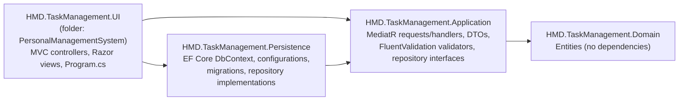

# Task Management System

A role-based work-order (task) management web application built with **ASP.NET Core MVC on .NET 8**, structured as an onion-style layered solution with **MediatR**, **FluentValidation** and **EF Core + SQL Server**. It was my Computer Engineering **capstone project**.

> Status: completed academic project, not deployed anywhere. Security-hardened afterwards (hashed passwords, POST + anti-forgery for state changes, per-user ownership checks) with integration tests and CI. See [Security](#security) and [Limitations](#limitations) before reusing any of it.

---

## Overview

Two roles share one application:

- **Admin**: creates and assigns work orders, manages members and priority levels, reads task reports, and receives notifications.
- **Member**: sees the work orders assigned to them, writes progress reports, marks work as completed, and receives assignment notifications.

Users sign in with cookie authentication and are routed to an `Admin` or `Member` MVC area based on their role. The UI text is in Turkish.

## Problem & Solution

**Problem:** In a small team, work requests, who owns them and how far along they are tend to live in chat messages and spreadsheets, so nobody has a single, current view.

**Solution:** One web app where an admin records each work order with a priority and start/end dates, assigns it to a member, and follows progress through the reports the member writes. Assignment, new reports and completion generate in-app notifications.

## Features

**Admin area** (`[Authorize(Roles = "Admin")]`)
- Dashboard with counts of work orders, members and unread notifications.
- Work orders: paginated list with search; create (title, description, priority, start/end date), update and assign to a member, delete. The edit page shows the task's reports.
- Members: paginated list with search; create, update, delete, reset password. Creating a member or resetting a password generates a random temporary password that is shown to the admin once.
- Priorities: create, update, delete.
- Notifications: list and mark as read.
- Own profile: update name, surname and password.

**Member area** (`[Authorize(Roles = "Member")]`)
- Assigned work orders: paginated list with search.
- Task reports: create, edit and delete progress reports per task.
- Mark a task as completed.
- Notifications and own profile.

**Account**
- Login, self-registration (always creates a Member), logout.

## Tech Stack

| Area | Technology (version from project files) |
|---|---|
| Runtime | .NET 8 (`net8.0`, all four projects) |
| Web | ASP.NET Core MVC, Razor views, MVC Areas, a view component |
| Application | MediatR 12.4.1 (requests and handlers), FluentValidation 11.11.0 |
| Data | Entity Framework Core 8.0.21, SQL Server provider, code-first migrations |
| Auth | ASP.NET Core cookie authentication with role claims; passwords hashed with ASP.NET Core Identity's `PasswordHasher<T>` (`Microsoft.Extensions.Identity.Core` 8.0.21) |
| Tests | xUnit 2.9, `Microsoft.AspNetCore.Mvc.Testing` (`WebApplicationFactory`) against SQL Server |
| Front end | Bootstrap 5, jQuery and jQuery Validation (vendored in `wwwroot`), Font Awesome (CDN) |

## Architecture

Dependencies point inward. This is taken from the `ProjectReference` entries in the `.csproj` files:



- **Request flow:** controller → `IMediator.Send(request)` → handler in Application → repository interface → EF Core implementation in Persistence → SQL Server.
- **Repository interfaces** (`IUserRepository`, `IAppTaskRepository`, `IPriorityRepository`, `ITaskReportRepository`, `INotificationRepository`) are defined in Application and implemented in Persistence. The Application project has no EF Core reference.
- **Validation:** each handler creates its FluentValidation validator and runs it before executing the use case. Validators are not registered in DI or in an MVC/MediatR pipeline.
- **Composition root:** `PersonalManagementSystem/Program.cs` calls `AddPersistenceServices` and `AddApplicationServices`, registers a global `AutoValidateAntiforgeryTokenAttribute`, configures the cookie (HttpOnly, `SameSite=Strict`) and maps the area and default routes. The default route opens `Account/Login`.
- **Domain entities:** `AppUser`, `AppRole`, `AppTasks`, `Priority`, `TaskReport`, `Notification`.

## Screenshots

These are the screenshots already in `docs/images/`. The UI is in Turkish.

| Admin dashboard | Admin: member management |
|---|---|
|  |  |
| **Admin: work order form** | **Member: assigned work orders** |
|  |  |

More screenshots: [admin work order list](docs/images/admin/admin-work-orders.png), [admin profile](docs/images/admin/admin-profile.png), [member profile](docs/images/member/member-profile.png), [member layout](docs/images/member/member-dashboard.png).

## Getting Started

### Prerequisites

- [.NET 8 SDK](https://dotnet.microsoft.com/download/dotnet/8.0)
- SQL Server. LocalDB (`(localdb)\MSSQLLocalDB`, installed with Visual Studio) works for local development.
- Optional: `dotnet-ef` for running migrations by hand (`dotnet tool install --global dotnet-ef`).

### Configuration

The app reads the connection string named **`Local`** (`ConnectionStrings:Local`). `PersonalManagementSystem/appsettings.json` ships with a LocalDB default that uses Windows integrated security and contains no password. If that works for you, you can skip this step.

To point at another server without editing tracked files, use an **environment variable**, which ASP.NET Core always reads:

```powershell
# PowerShell
$env:ConnectionStrings__Local = "Server=<host>;Database=TaskManagementDb;User Id=<user>;Password=<password>;TrustServerCertificate=True"
```

```bash
# bash
export ConnectionStrings__Local="Server=<host>;Database=TaskManagementDb;User Id=<user>;Password=<password>;TrustServerCertificate=True"
```

You can also use **user-secrets**. The UI project has no `UserSecretsId` yet, so initialise it first (this adds a `UserSecretsId` to the `.csproj` on your machine):

```bash
dotnet user-secrets init --project PersonalManagementSystem
dotnet user-secrets set "ConnectionStrings:Local" "<your connection string>" --project PersonalManagementSystem
```

Do not commit credentials to `appsettings*.json`.

### Database and migrations

Migrations live in `HMD.TaskManagement.Persistence/Migrations`. **On startup the app calls `Database.Migrate()`**, so the database is created and updated automatically if the connection string works. Startup also inserts the two role rows (`1 = Admin`, `2 = Member`) when they are missing.

To apply migrations by hand instead:

```bash
dotnet ef database update --project HMD.TaskManagement.Persistence --startup-project PersonalManagementSystem
```

### Run

```bash
dotnet restore PersonalManagementSystem.sln
dotnet build PersonalManagementSystem.sln
dotnet run --project PersonalManagementSystem --launch-profile https
```

Then open `https://localhost:7276` (from `Properties/launchSettings.json`).

> On Windows, the UI `.csproj` has a pre-build step that runs `taskkill` on any running `HMD.TaskManagement.UI.exe` and `iisexpress.exe` processes to avoid locked-file errors.

### First admin account

No users are seeded, and self-registration always creates a **Member**. To get an admin:

1. Register at `/Account/Register`.
2. Promote that user in SQL Server:
   ```sql
   UPDATE Users SET AppRoleId = 1 WHERE UserName = N'<your-username>';
   ```
3. Sign out and sign in again.

Notifications for new reports and completed tasks are sent to every user with the Admin role.

## Security

What the application does today:

- **Password storage.** Passwords are hashed with ASP.NET Core Identity's `PasswordHasher<AppUser>` (PBKDF2, per-user salt). Registration, admin-created members, admin password resets and profile changes all store hashes. The hash is never returned to the UI, and the profile page has an empty "new password" field (blank keeps the current password).
- **Minimum password length.** New passwords (registration and profile) must be 8–128 characters.
- **No default password.** Creating a member or resetting a member's password generates a random 16-character temporary password. It is rendered once in the POST response (with `Cache-Control: no-store`); only its hash is stored. Hand it to the user over a secure channel and ask them to change it on their profile page.
- **Legacy plain-text passwords** are migrated on login without locking anyone out. See [Upgrading an existing database](#upgrading-an-existing-database).
- **State-changing requests** (delete, complete, reset password, mark as read, log out, and all forms) are `POST` only and need a valid anti-forgery token. A global `AutoValidateAntiforgeryTokenAttribute` rejects a missing or invalid token with `400`. A `GET` to these URLs is rejected (`405`, or `404` where no `GET` route exists) and changes nothing.
- **Authorization.** The Admin and Member areas keep their role checks. Member actions also check ownership in the Application handlers: a member can only complete, report on, edit or delete reports of tasks assigned to them, and anyone can only mark their own notifications as read. Profile updates always use the signed-in user's id, never one from the form. Admin member-management actions only affect users with the Member role. If a resource is not found or belongs to someone else, the response is `404`.
- **Logging.** The debug code that wrote usernames and exception messages to a local file has been removed. Unexpected login errors go to the standard ASP.NET Core logger, without request data.

### Upgrading an existing database

No schema change was needed: the `Password` column is `nvarchar(200)` and a hash is 84 characters. There is no new migration.

Existing rows that still hold a plain-text password keep working. On the next successful login the stored value is detected as "not a hasher-format hash" and compared to the supplied password in constant time (both sides are reduced to SHA-256 digests first, then compared with `CryptographicOperations.FixedTimeEquals`). If they match, the value is replaced with a hash right away. Hashes that `PasswordHasher` reports as `SuccessRehashNeeded` (older format or iteration count) are rehashed the same way. Accounts that never log in again keep their plain-text value until an admin resets their password. To close that gap, reset those accounts or run a one-off script that resets every row which is not in hasher format.

## Testing

`HMD.TaskManagement.Tests` (xUnit) has unit tests for the password helpers and integration tests that boot the real application with `WebApplicationFactory<Program>`. They use the real `Program.cs` pipeline (MVC filters, cookie auth, anti-forgery) and a real SQL Server database. Each test run creates a database named `TmsTests_<guid>`, applies the EF Core migrations through the normal startup path and drops the database at the end.

SQL Server rather than SQLite or the in-memory provider: the migrations and the startup schema fixes are SQL Server specific, and the in-memory provider would not exercise real queries, constraints or cascades.

They cover: hashing on register, member create, reset and profile change; correct, wrong and unknown-user logins; legacy plain-text login being migrated to a hash; `GET` not deleting or changing data; missing, invalid or foreign anti-forgery tokens being rejected; unauthenticated requests being redirected to login; members not reaching admin pages or actions; members not acting on another member's tasks, reports, notifications or profile; and the valid, authorized versions of these operations succeeding.

```bash
# Uses SQL Server LocalDB by default: (localdb)\MSSQLLocalDB
dotnet test PersonalManagementSystem.sln

# Any other SQL Server: give a connection string without a database name
export TMS_TEST_SQLSERVER="Server=localhost,1433;User ID=sa;Password=<password>;TrustServerCertificate=True"
dotnet test PersonalManagementSystem.sln
```

The account in `TMS_TEST_SQLSERVER` must be allowed to create and drop databases. On Windows, building the tests also builds the UI project, and its pre-build step runs `taskkill` on `HMD.TaskManagement.UI.exe` and `iisexpress.exe`. Stop any instance you care about first.

### CI

`.github/workflows/ci.yml` runs on pushes to `master`, on pull requests and on manual dispatch. It runs on `ubuntu-latest` and starts a SQL Server 2022 container with a per-run random SA password. It then restores, builds (Release) and runs all tests, and uploads the TRX results as an artifact.

## Project Status

- Built as a Computer Engineering capstone project between February and May 2025.
- Small follow-up changes in May 2026: a migration that makes a task's assignee nullable, plus documentation and screenshots.
- Not deployed, and not maintained as a product.

## My Contributions

This is a solo project. Every commit in the history is mine. I designed the layered solution structure, the domain model and EF Core mappings, the MediatR request/handler and validation flow, cookie-based role authorization, and the Admin and Member MVC areas with their Razor views and styling. The vendored front-end libraries and the UI template listed below are third-party code.

## Limitations

These are known issues in the current code. I am listing them openly rather than hiding them:

- **Plain-text passwords remain until the next login.** Legacy accounts are migrated only when they log in successfully (see [Upgrading an existing database](#upgrading-an-existing-database)).
- **Temporary passwords are not forced to change.** After an admin creates a member or resets a password, nothing forces the user to change it at the next login. That would need a new column and a migration.
- **No brute-force protection.** There is no account lockout, rate limiting or CAPTCHA on login. Changing your password on the profile page does not ask for the current password. Existing auth cookies stay valid after a password change, because there is no security-stamp check.
- **User names are not unique in the schema.** Registration and member creation now reject a user name that is already taken, but the database has no unique index on `UserName`. Instead, the existing unique index is on `Surname`, which is a schema quirk. Login checks every row with the given user name.
- **Access denied page:** the cookie handler redirects forbidden requests to `/Account/AccessDenied`, which has no action, so the user sees a 404 page.
- Startup runs `Database.Migrate()` and raw SQL schema fixes automatically. That is convenient for a demo but not what you want in production.
- No containerisation, no logging or monitoring setup.
- The UI is Turkish-only. The `wwwroot` folder contains three copies of Bootstrap (see below).

## Third-party code and licences

Vendored under `PersonalManagementSystem/wwwroot/` (all MIT-licensed, with their licence headers or files kept in place):

| Path | Component |
|---|---|
| `lib/bootstrap`, `lib/jquery`, `lib/jquery-validation`, `lib/jquery-validation-unobtrusive` | Default ASP.NET Core MVC template libraries (Bootstrap 5.1, jQuery 3.6, jQuery Validation 1.19.5, jQuery Validation Unobtrusive), each with its `LICENSE` file |
| `bootstrap/`, `twitter-bootstrap/` | Bootstrap 5.3.3, restored via LibMan (`libman.json`) |
| `theme/` | [Start Bootstrap "Simple Sidebar"](https://startbootstrap.com/template/simple-sidebar) v6.0.6, MIT, by Start Bootstrap |

`.gitattributes` marks these folders as `linguist-vendored`, so GitHub's language bar counts only the first-party code. It also marks EF Core migration designer files as `linguist-generated`.

Font Awesome and one Bootstrap bundle are loaded from public CDNs at runtime. NuGet dependencies (MediatR, FluentValidation, EF Core) are restored at build time and are not vendored.

The repository does not currently include a licence for its own code.
