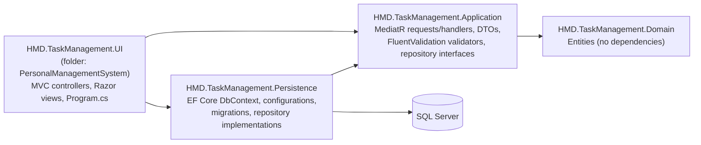
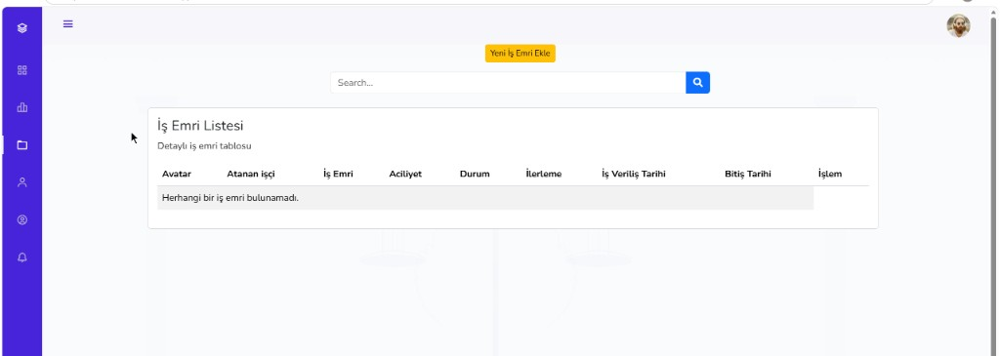
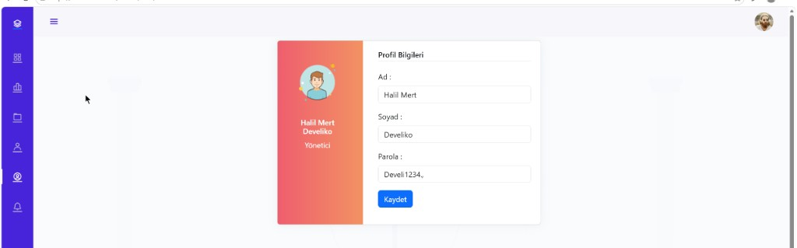
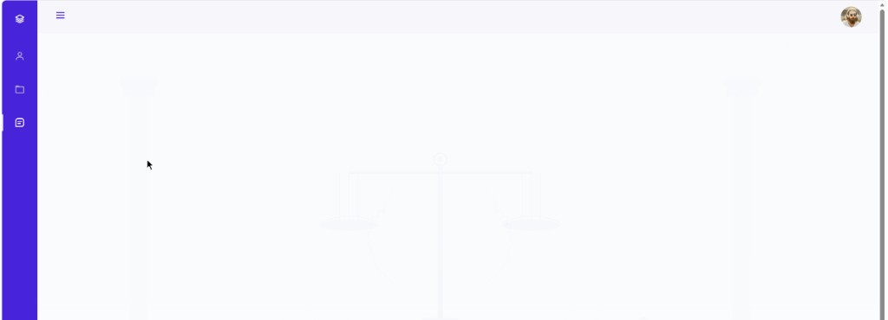
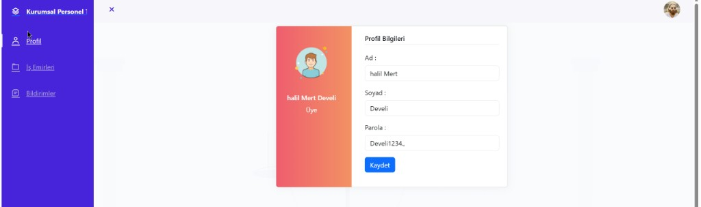

<div align="center">

# Task Management System

**A role-based work-order manager for small teams, built with ASP.NET Core MVC on .NET 8 in an onion-style layered solution.**
<br/>
<sub>Küçük ekipler için rol tabanlı iş emri yönetim uygulaması; .NET 8 üzerinde ASP.NET Core MVC ile, onion tarzı katmanlı bir çözüm olarak geliştirildi.</sub>

<br/>


</div>

<p align="center"><a href="#english">English</a> · <a href="#turkce">Türkçe</a></p>

| | |
|---|---|
| **Type · Tür** | Web application (server-rendered MVC) · Web uygulaması (sunucu taraflı MVC) |
| **Status · Durum** | Completed capstone project, not deployed · Tamamlanmış bitirme projesi, yayında değil |
| **Stack · Teknoloji** | .NET 8, ASP.NET Core MVC, MediatR 12.4.1, FluentValidation 11.11.0, EF Core 8.0.0, SQL Server |
| **Architecture · Mimari** | Onion-style: Domain, Application, Persistence, UI · Onion tarzı: Domain, Application, Persistence, UI |
| **Roles · Roller** | Admin, Member · Yönetici, Üye |
| **Category · Kategori** | Portfolio / Academic · Portföy / Akademik |

<p align="center">
  
  <br/>
  <sub>Admin dashboard · Yönetici paneli (the UI is in Turkish · arayüz Türkçedir)</sub>
</p>

---

<a id="english"></a>

## Overview

Task Management System was my Computer Engineering **capstone project**. Two roles share one application:

- **Admin** creates and assigns work orders, manages members and priority levels, reads task reports and receives notifications.
- **Member** sees the work orders assigned to them, writes progress reports, marks work as completed and receives assignment notifications.

Users sign in with cookie authentication and are routed to an `Admin` or `Member` MVC area based on their role. The UI text is in Turkish.

> [!WARNING]
> Completed academic project, not production-ready: passwords are stored in plain text, and there are no automated tests and no CI. Read [Limitations](#limitations) before reusing any of it.

## Problem and solution

**Problem:** in a small team, work requests, who owns them and how far along they are tend to live in chat messages and spreadsheets, so nobody has a single, current view.

**Solution:** one web app where an admin records each work order with a priority and start/end dates, assigns it to a member, and follows progress through the reports the member writes. Assignment, new reports and completion generate in-app notifications.

## Features

| Area | Capability | Where |
|---|---|---|
| Admin: dashboard | Counts of work orders, members and unread notifications | `Controllers/Admin/HomeController.cs`, `Handlers/Dashboard` |
| Admin: work orders | Paginated list with search; create (title, description, priority, start/end date), update, assign to a member, delete; the edit page shows the task's reports | `Controllers/Admin/AppTaskController.cs`, `Handlers/AppTask` |
| Admin: members | Paginated list with search; create, update, delete, reset password | `Controllers/Admin/UserController.cs`, `Handlers/Account` |
| Admin: priorities | Create, update, delete | `Controllers/Admin/PriorityController.cs`, `Handlers/Priority` |
| Member: work orders | Assigned work orders with search; mark a task as completed | `Controllers/Member/AppTaskController.cs` |
| Member: task reports | Create, edit and delete progress reports per task | `Handlers/TaskReport`, `ViewComponents/TaskReportsViewComponent.cs` |
| Both: notifications | List and mark as read | `Controllers/*/NotificationController.cs`, `Handlers/Notification` |
| Both: profile | Update name, surname and password | `Controllers/*/UserController.cs` |
| Account | Login, self-registration (always creates a Member), logout | `Controllers/AccountController.cs` |

Admin and Member controllers are protected with `[Authorize(Roles = "Admin")]` and `[Authorize(Roles = "Member")]`.

## Tech stack

| Area | Technology (version from project files) |
|---|---|
| Runtime | .NET 8 (`net8.0`, all four projects) |
| Web | ASP.NET Core MVC, Razor views, MVC Areas, a view component |
| Application | MediatR 12.4.1 (requests and handlers), FluentValidation 11.11.0 |
| Data | Entity Framework Core 8.0.0, SQL Server provider, code-first migrations |
| Auth | ASP.NET Core cookie authentication with role claims |
| Front end | Bootstrap 5, jQuery and jQuery Validation (vendored in `wwwroot`), Font Awesome (CDN) |

## Architecture

Dependencies point inward. The diagram is taken from the `ProjectReference` entries in the `.csproj` files.



<sub>Project references between the four .NET projects · Dört .NET projesi arasındaki proje referansları</sub>

- **Request flow:** controller → `IMediator.Send(request)` → handler in Application → repository interface → EF Core implementation in Persistence → SQL Server.
- **Repository interfaces** (`IUserRepository`, `IAppTaskRepository`, `IPriorityRepository`, `ITaskReportRepository`, `INotificationRepository`) are defined in Application and implemented in Persistence. The Application project has no EF Core reference.
- **Validation:** each handler creates its FluentValidation validator and runs it before executing the use case. Validators are not registered in DI or in an MVC/MediatR pipeline.
- **Composition root:** `PersonalManagementSystem/Program.cs` calls `AddPersistenceServices` and `AddApplicationServices`, configures the cookie (`PersonalManagementLCookie`, HttpOnly, `SameSite=Strict`) and maps the area and default routes. The default route opens `Account/Login`.

## Repository structure

```text
TaskManagementSystem/
├── HMD.TaskManagement.Domain/        # Entities: AppUser, AppRole, AppTasks, Priority, TaskReport, Notification
├── HMD.TaskManagement.Application/   # MediatR requests + handlers, DTOs, validators, repository interfaces
├── HMD.TaskManagement.Persistence/   # DbContext, entity configurations, migrations, repositories
├── PersonalManagementSystem/         # UI project (HMD.TaskManagement.UI.csproj)
│   ├── Areas/Admin, Areas/Member     # Razor views per role
│   ├── Controllers/Admin, /Member    # Role-protected MVC controllers
│   ├── ViewComponents/               # TaskReportsViewComponent
│   └── Program.cs                    # Composition root, cookie auth, startup migration
├── docs/images/                      # Screenshots
└── PersonalManagementSystem.sln
```

## Data and authentication

- **Entities:** `AppUser`, `AppRole`, `AppTasks`, `Priority`, `TaskReport`, `Notification`, mapped with EF Core configuration classes in `HMD.TaskManagement.Persistence/Configurations`.
- **Migrations** live in `HMD.TaskManagement.Persistence/Migrations` (four migrations, February 2025 to May 2026).
- **Startup:** `Program.cs` calls `Database.Migrate()`, runs a raw SQL fix that makes the task assignee column nullable when needed, and inserts the two role rows (`1 = Admin`, `2 = Member`) when they are missing.
- **Auth:** cookie authentication with a role claim; login compares the stored password directly (see [Limitations](#limitations)).

## Getting started

### Prerequisites

- [.NET 8 SDK](https://dotnet.microsoft.com/download/dotnet/8.0)
- SQL Server. LocalDB (`(localdb)\MSSQLLocalDB`, installed with Visual Studio) works for local development.
- Optional: `dotnet-ef` for running migrations by hand (`dotnet tool install --global dotnet-ef`).

### Configuration

The app reads the connection string named **`Local`** (`ConnectionStrings:Local`). `PersonalManagementSystem/appsettings.json` ships with a LocalDB default that uses Windows integrated security and contains no password. To point at another server without editing tracked files, use an environment variable:

```powershell
# PowerShell
$env:ConnectionStrings__Local = "<your-connection-string>"
```

```bash
# bash
export ConnectionStrings__Local="<your-connection-string>"
```

Or use user-secrets. The UI project has no `UserSecretsId` yet, so initialise it first:

```bash
dotnet user-secrets init --project PersonalManagementSystem
dotnet user-secrets set "ConnectionStrings:Local" "<your-connection-string>" --project PersonalManagementSystem
```

Do not commit credentials to `appsettings*.json`.

### Run

```bash
dotnet restore PersonalManagementSystem.sln
dotnet build PersonalManagementSystem.sln
dotnet run --project PersonalManagementSystem --launch-profile https
```

Then open `https://localhost:7276` (from `Properties/launchSettings.json`). The database is created and migrated on first start. To apply migrations by hand instead:

```bash
dotnet ef database update --project HMD.TaskManagement.Persistence --startup-project PersonalManagementSystem
```

> On Windows, the UI `.csproj` has a pre-build step that runs `taskkill` on any running `HMD.TaskManagement.UI.exe` and `iisexpress.exe` processes to avoid locked-file errors.

### First admin account

No users are seeded, and self-registration always creates a **Member**. To get an admin:

1. Register at `/Account/Register`.
2. Promote that user in SQL Server:
   ```sql
   UPDATE Users SET AppRoleId = 1 WHERE UserName = N'<your-username>';
   ```
3. Sign out and sign in again.

Notifications for new reports and completed tasks are always sent to the user with **Id 1**, so on a fresh database the first registered account should be the admin.

## Testing and CI

There are **no automated tests** and **no CI pipeline**. The solution builds with the .NET 8 SDK (`dotnet build` checked on 2026-11-03: 0 errors, nullable-reference warnings in the Application handlers). All functional verification so far has been manual, through the UI.

## Screenshots

| | |
|---|---|
|  |  |
| <sub>Admin: member management · Yönetici: üye yönetimi</sub> | <sub>Admin: work orders · Yönetici: iş emirleri</sub> |
|  |  |
| <sub>Admin: work order form · Yönetici: iş emri formu</sub> | <sub>Admin: profile · Yönetici: profil</sub> |
|  |  |
| <sub>Member: assigned work orders · Üye: atanan iş emirleri</sub> | <sub>Member: layout · Üye: arayüz</sub> |
|  | |
| <sub>Member: profile · Üye: profil</sub> | |

## Engineering notes

- **Why MediatR:** controllers stay thin and every use case is one request/handler pair, so the Application layer is the single place to read business rules.
- **Trade-off:** validators are instantiated inside handlers instead of a MediatR pipeline behaviour. It is explicit and easy to follow, but every handler repeats the same pattern.
- **Startup schema repair:** `Program.cs` tolerates databases that missed the nullable-assignee migration. Convenient for a demo; in production, migrations would run as a separate deployment step.

## Limitations

These are known issues in the current code:

- **Passwords are stored and compared in plain text.** There is no hashing (`AppUser.Password`, `LoginRequestHandler`).
- **Admin-created members and password resets use a fixed default password** that is hard-coded in the Application handlers.
- **No per-user authorization checks on member actions.** Reports and task completion are addressed by id, and the handlers do not check that the task belongs to the signed-in member. Several state-changing actions (delete, complete, mark as read) are plain `GET` links, and no anti-forgery validation is applied. The `SameSite=Strict` cookie reduces, but does not remove, the CSRF exposure.
- **Notifications assume a single admin with user Id 1** (hard-coded in `TaskReportCreateHandler` and `AppTaskCompleteRequestHandler`).
- **Leftover debug instrumentation:** `LoginRequestHandler`, `AccountController` and the Persistence `IOCExtensions` append JSON lines (including login usernames) to a hard-coded local file path. Failures are swallowed, so on other machines this does nothing, but it should be removed.
- Startup runs `Database.Migrate()` and raw SQL schema fixes automatically.
- No tests, no CI, no containerisation, no logging or monitoring setup.
- The UI is Turkish-only. `wwwroot` contains three copies of Bootstrap.

## Project status

- Built as a Computer Engineering capstone project between February and May 2025.
- Small follow-up changes in May 2026: a migration that makes a task's assignee nullable, plus documentation and screenshots.
- Not deployed and not maintained as a product.

## My contributions

This is a solo project; every commit in the history is mine. I designed the layered solution structure, the domain model and EF Core mappings, the MediatR request/handler and validation flow, cookie-based role authorization, and the Admin and Member MVC areas with their Razor views and styling. The vendored front-end libraries and the UI template listed below are third-party code.

## Third-party code and licences

Vendored under `PersonalManagementSystem/wwwroot/` (all MIT-licensed, with their licence headers or files kept in place):

| Path | Component |
|---|---|
| `lib/bootstrap`, `lib/jquery`, `lib/jquery-validation`, `lib/jquery-validation-unobtrusive` | Default ASP.NET Core MVC template libraries (Bootstrap 5.1, jQuery 3.6, jQuery Validation 1.19.5, jQuery Validation Unobtrusive), each with its `LICENSE` file |
| `bootstrap/`, `twitter-bootstrap/` | Bootstrap 5.3.3, restored via LibMan (`libman.json`) |
| `theme/` | [Start Bootstrap "Simple Sidebar"](https://startbootstrap.com/template/simple-sidebar) v6.0.6, MIT, by Start Bootstrap |

Font Awesome and one Bootstrap bundle are loaded from public CDNs at runtime. NuGet dependencies are restored at build time and are not vendored. The repository does not currently include a licence for its own code.

<p align="right"><a href="#english">Back to top ↑</a></p>

---

<a id="turkce"></a>

## Genel Bakış

Task Management System, Bilgisayar Mühendisliği **bitirme projem** olarak geliştirildi. Tek uygulamayı iki rol paylaşır:

- **Yönetici (Admin)** iş emirlerini oluşturur ve atar, üyeleri ve öncelik seviyelerini yönetir, görev raporlarını okur ve bildirim alır.
- **Üye (Member)** kendisine atanan iş emirlerini görür, ilerleme raporları yazar, işi tamamlandı olarak işaretler ve atama bildirimleri alır.

Kullanıcılar cookie tabanlı kimlik doğrulama ile giriş yapar ve rollerine göre `Admin` veya `Member` MVC alanına yönlendirilir. Arayüz metinleri Türkçedir.

> [!WARNING]
> Tamamlanmış akademik bir projedir, canlı kullanıma hazır değildir: parolalar düz metin olarak saklanır; otomatik test ve CI yoktur. Yeniden kullanmadan önce [Sınırlamalar](#sinirlamalar) bölümünü okuyun.

## Problem ve Çözüm

**Problem:** küçük ekiplerde iş talepleri, sorumluları ve ilerleme durumu genellikle sohbet mesajlarında ve tablolarda kalır; kimsenin tek ve güncel bir görünümü olmaz.

**Çözüm:** yöneticinin her iş emrini öncelik ve başlangıç/bitiş tarihleriyle kaydettiği, bir üyeye atadığı ve üyenin yazdığı raporlarla ilerlemeyi takip ettiği tek bir web uygulaması. Atama, yeni rapor ve tamamlama işlemleri uygulama içi bildirim üretir.

## Özellikler

| Alan | Yetenek | Konum |
|---|---|---|
| Yönetici: panel | İş emri, üye ve okunmamış bildirim sayıları | `Controllers/Admin/HomeController.cs`, `Handlers/Dashboard` |
| Yönetici: iş emirleri | Arama destekli sayfalı liste; oluşturma (başlık, açıklama, öncelik, başlangıç/bitiş tarihi), güncelleme, üyeye atama, silme; düzenleme sayfasında görevin raporları | `Controllers/Admin/AppTaskController.cs`, `Handlers/AppTask` |
| Yönetici: üyeler | Arama destekli sayfalı liste; oluşturma, güncelleme, silme, parola sıfırlama | `Controllers/Admin/UserController.cs`, `Handlers/Account` |
| Yönetici: öncelikler | Oluşturma, güncelleme, silme | `Controllers/Admin/PriorityController.cs`, `Handlers/Priority` |
| Üye: iş emirleri | Atanan iş emirlerinde arama; görevi tamamlandı olarak işaretleme | `Controllers/Member/AppTaskController.cs` |
| Üye: görev raporları | Görev başına ilerleme raporu oluşturma, düzenleme, silme | `Handlers/TaskReport`, `ViewComponents/TaskReportsViewComponent.cs` |
| Ortak: bildirimler | Listeleme ve okundu olarak işaretleme | `Controllers/*/NotificationController.cs`, `Handlers/Notification` |
| Ortak: profil | Ad, soyad ve parola güncelleme | `Controllers/*/UserController.cs` |
| Hesap | Giriş, kendi kendine kayıt (her zaman Üye oluşturur), çıkış | `Controllers/AccountController.cs` |

Yönetici ve Üye controller'ları `[Authorize(Roles = "Admin")]` ve `[Authorize(Roles = "Member")]` ile korunur.

## Teknoloji Yığını

| Alan | Teknoloji (sürümler proje dosyalarından) |
|---|---|
| Çalışma ortamı | .NET 8 (dört projede de `net8.0`) |
| Web | ASP.NET Core MVC, Razor view'lar, MVC Areas, bir view component |
| Uygulama katmanı | MediatR 12.4.1 (request ve handler'lar), FluentValidation 11.11.0 |
| Veri | Entity Framework Core 8.0.0, SQL Server provider, code-first migration'lar |
| Kimlik doğrulama | Rol claim'li ASP.NET Core cookie authentication |
| Ön yüz | Bootstrap 5, jQuery ve jQuery Validation (`wwwroot` içinde), Font Awesome (CDN) |

## Mimari

Bağımlılıklar içe doğrudur. Diyagram `.csproj` dosyalarındaki `ProjectReference` kayıtlarından çıkarılmıştır.


<sub>Dört .NET projesi arasındaki proje referansları · Project references between the four .NET projects</sub>

- **İstek akışı:** controller → `IMediator.Send(request)` → Application içindeki handler → repository arayüzü → Persistence içindeki EF Core implementasyonu → SQL Server.
- **Repository arayüzleri** (`IUserRepository`, `IAppTaskRepository`, `IPriorityRepository`, `ITaskReportRepository`, `INotificationRepository`) Application katmanında tanımlanır, Persistence katmanında uygulanır. Application projesinin EF Core referansı yoktur.
- **Doğrulama:** her handler kendi FluentValidation validator'ını oluşturur ve use case'i çalıştırmadan önce uygular. Validator'lar DI'a veya bir MVC/MediatR pipeline'ına kayıtlı değildir.
- **Composition root:** `PersonalManagementSystem/Program.cs`, `AddPersistenceServices` ve `AddApplicationServices` çağrılarını yapar, cookie'yi (`PersonalManagementLCookie`, HttpOnly, `SameSite=Strict`) yapılandırır, area ve varsayılan route'ları tanımlar. Varsayılan route `Account/Login` sayfasını açar.

## Depo Yapısı

```text
TaskManagementSystem/
├── HMD.TaskManagement.Domain/        # Entity'ler: AppUser, AppRole, AppTasks, Priority, TaskReport, Notification
├── HMD.TaskManagement.Application/   # MediatR request + handler'lar, DTO'lar, validator'lar, repository arayüzleri
├── HMD.TaskManagement.Persistence/   # DbContext, entity yapılandırmaları, migration'lar, repository'ler
├── PersonalManagementSystem/         # UI projesi (HMD.TaskManagement.UI.csproj)
│   ├── Areas/Admin, Areas/Member     # Role göre Razor view'lar
│   ├── Controllers/Admin, /Member    # Rol korumalı MVC controller'lar
│   ├── ViewComponents/               # TaskReportsViewComponent
│   └── Program.cs                    # Composition root, cookie auth, açılışta migration
├── docs/images/                      # Ekran görüntüleri
└── PersonalManagementSystem.sln
```

## Veri ve Kimlik Doğrulama

- **Entity'ler:** `AppUser`, `AppRole`, `AppTasks`, `Priority`, `TaskReport`, `Notification`; `HMD.TaskManagement.Persistence/Configurations` içindeki EF Core yapılandırma sınıflarıyla eşlenir.
- **Migration'lar** `HMD.TaskManagement.Persistence/Migrations` klasöründedir (Şubat 2025 ile Mayıs 2026 arasında dört migration).
- **Açılış:** `Program.cs`, `Database.Migrate()` çağırır, gerekirse görev atanan kişi sütununu nullable yapan ham bir SQL düzeltmesi çalıştırır ve eksikse iki rol kaydını (`1 = Admin`, `2 = Member`) ekler.
- **Kimlik doğrulama:** rol claim'li cookie authentication; giriş sırasında saklanan parola doğrudan karşılaştırılır (bkz. [Sınırlamalar](#sinirlamalar)).

## Kurulum

### Gereksinimler

- [.NET 8 SDK](https://dotnet.microsoft.com/download/dotnet/8.0)
- SQL Server. Yerel geliştirme için LocalDB (`(localdb)\MSSQLLocalDB`, Visual Studio ile gelir) yeterlidir.
- İsteğe bağlı: migration'ları elle çalıştırmak için `dotnet-ef` (`dotnet tool install --global dotnet-ef`).

### Yapılandırma

Uygulama **`Local`** adlı bağlantı dizesini (`ConnectionStrings:Local`) okur. `PersonalManagementSystem/appsettings.json`, Windows tümleşik güvenliğini kullanan ve parola içermeyen bir LocalDB varsayılanıyla gelir. Takip edilen dosyaları değiştirmeden başka bir sunucu kullanmak için ortam değişkeni tanımlayın:

```powershell
# PowerShell
$env:ConnectionStrings__Local = "<your-connection-string>"
```

```bash
# bash
export ConnectionStrings__Local="<your-connection-string>"
```

Ya da user-secrets kullanın. UI projesinde henüz `UserSecretsId` olmadığı için önce başlatın:

```bash
dotnet user-secrets init --project PersonalManagementSystem
dotnet user-secrets set "ConnectionStrings:Local" "<your-connection-string>" --project PersonalManagementSystem
```

Kimlik bilgilerini `appsettings*.json` dosyalarına commit etmeyin.

### Çalıştırma

```bash
dotnet restore PersonalManagementSystem.sln
dotnet build PersonalManagementSystem.sln
dotnet run --project PersonalManagementSystem --launch-profile https
```

Ardından `https://localhost:7276` adresini açın (`Properties/launchSettings.json`). Veritabanı ilk açılışta oluşturulur ve migration'lar uygulanır. Migration'ları elle uygulamak için:

```bash
dotnet ef database update --project HMD.TaskManagement.Persistence --startup-project PersonalManagementSystem
```

> Windows'ta UI `.csproj` dosyası, kilitli dosya hatalarını önlemek için derlemeden önce çalışan `HMD.TaskManagement.UI.exe` ve `iisexpress.exe` süreçlerini `taskkill` ile kapatır.

### İlk yönetici hesabı

Hazır kullanıcı yoktur ve kendi kendine kayıt her zaman **Üye** oluşturur. Yönetici hesabı için:

1. `/Account/Register` adresinden kayıt olun.
2. Kullanıcıyı SQL Server'da yükseltin:
   ```sql
   UPDATE Users SET AppRoleId = 1 WHERE UserName = N'<your-username>';
   ```
3. Çıkış yapıp tekrar giriş yapın.

Yeni rapor ve tamamlanan görev bildirimleri her zaman **Id değeri 1** olan kullanıcıya gider; bu yüzden boş bir veritabanında ilk kayıt olan hesap yönetici olmalıdır.

## Test ve CI

**Otomatik test** ve **CI pipeline'ı yoktur**. Çözüm .NET 8 SDK ile derlenir (`dotnet build` 2026-11-03 tarihinde denendi: 0 hata, Application handler'larında nullable referans uyarıları). Şimdiye kadarki tüm işlevsel doğrulama arayüz üzerinden elle yapılmıştır.

## Ekran Görüntüleri

Ekran görüntüleri yukarıdaki [Screenshots](#screenshots) bölümünde iki dilli başlıklarla bir kez yer alır.

## Mühendislik Notları

- **Neden MediatR:** controller'lar ince kalır ve her use case tek bir request/handler çiftidir; iş kurallarını okumak için tek yer Application katmanıdır.
- **Ödünleşim:** validator'lar bir MediatR pipeline behavior yerine handler içinde oluşturulur. Açık ve takip etmesi kolaydır, ancak her handler aynı kalıbı tekrar eder.
- **Açılışta şema onarımı:** `Program.cs`, nullable atanan kişi migration'ını kaçırmış veritabanlarını tolere eder. Demo için pratiktir; canlı ortamda migration'lar ayrı bir dağıtım adımı olarak çalıştırılmalıdır.

<a id="sinirlamalar"></a>

## Sınırlamalar

Mevcut koddaki bilinen sorunlar:

- **Parolalar düz metin olarak saklanır ve karşılaştırılır.** Hash'leme yoktur (`AppUser.Password`, `LoginRequestHandler`).
- **Yöneticinin oluşturduğu üyeler ve parola sıfırlama sabit bir varsayılan parola kullanır**; bu parola Application handler'larında koda gömülüdür.
- **Üye işlemlerinde kullanıcıya özel yetki kontrolü yoktur.** Raporlar ve görev tamamlama id ile adreslenir ve handler'lar görevin giriş yapmış üyeye ait olup olmadığını kontrol etmez. Durum değiştiren bazı işlemler (silme, tamamlama, okundu işaretleme) düz `GET` linkleridir ve anti-forgery doğrulaması uygulanmaz. `SameSite=Strict` cookie CSRF riskini azaltır ama ortadan kaldırmaz.
- **Bildirimler, Id değeri 1 olan tek bir yönetici varsayar** (`TaskReportCreateHandler` ve `AppTaskCompleteRequestHandler` içinde koda gömülü).
- **Kalmış debug kodu:** `LoginRequestHandler`, `AccountController` ve Persistence `IOCExtensions`, koda gömülü yerel bir dosya yoluna JSON satırları (giriş kullanıcı adları dahil) ekler. Hatalar yutulduğu için başka makinelerde etkisi yoktur, ancak kaldırılmalıdır.
- Açılışta `Database.Migrate()` ve ham SQL şema düzeltmeleri otomatik çalışır.
- Test, CI, container yapılandırması, loglama veya izleme kurulumu yoktur.
- Arayüz yalnızca Türkçedir. `wwwroot` içinde üç ayrı Bootstrap kopyası bulunur.

## Proje Durumu

- Şubat ile Mayıs 2025 arasında Bilgisayar Mühendisliği bitirme projesi olarak geliştirildi.
- Mayıs 2026'da küçük güncellemeler yapıldı: görevin atanan kişisini nullable yapan bir migration, dokümantasyon ve ekran görüntüleri.
- Yayına alınmadı ve bir ürün olarak bakımı yapılmıyor.

## Katkılarım

Tek kişilik bir projedir; geçmişteki tüm commit'ler bana aittir. Katmanlı çözüm yapısını, domain modelini ve EF Core eşlemelerini, MediatR request/handler ve doğrulama akışını, cookie tabanlı rol yetkilendirmesini ve Yönetici ile Üye MVC alanlarını Razor view'ları ve stilleriyle birlikte tasarladım. Aşağıda listelenen ön yüz kütüphaneleri ve arayüz şablonu üçüncü taraf kodudur.

## Üçüncü Taraf Kod ve Lisanslar

`PersonalManagementSystem/wwwroot/` altında bulunanlar (hepsi MIT lisanslı; lisans başlıkları veya dosyaları korunmuştur):

| Yol | Bileşen |
|---|---|
| `lib/bootstrap`, `lib/jquery`, `lib/jquery-validation`, `lib/jquery-validation-unobtrusive` | Varsayılan ASP.NET Core MVC şablon kütüphaneleri (Bootstrap 5.1, jQuery 3.6, jQuery Validation 1.19.5, jQuery Validation Unobtrusive), her biri `LICENSE` dosyasıyla |
| `bootstrap/`, `twitter-bootstrap/` | LibMan ile indirilen Bootstrap 5.3.3 (`libman.json`) |
| `theme/` | Start Bootstrap'in ["Simple Sidebar"](https://startbootstrap.com/template/simple-sidebar) şablonu v6.0.6, MIT |

Font Awesome ve bir Bootstrap paketi çalışma zamanında herkese açık CDN'lerden yüklenir. NuGet bağımlılıkları derleme sırasında indirilir, depoya eklenmemiştir. Depo şu an kendi kodu için bir lisans içermiyor.

<p align="right"><a href="#turkce">Başa dön ↑</a></p>
